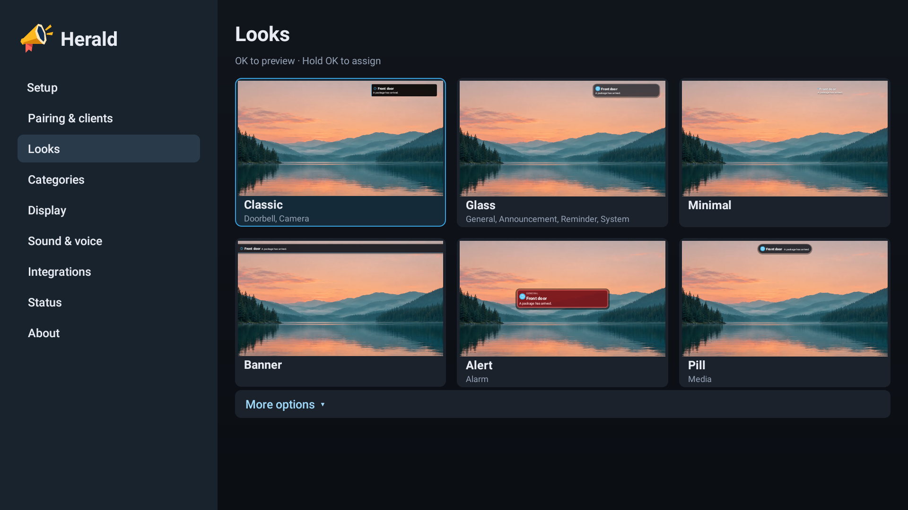

# Herald

Herald shows notifications over the current app on Android TV and Google TV. A card can display text, a still image or live video and accept a response from the remote. Status chips stay visible between notifications. Announcements use the TV output or the box speaker. A single request can show a card and speak its title and message. Choose one of six built-in looks, copy a custom look or set a category default on the TV. Home Assistant can prepare a shared voice for boxes and Cast speakers.

### Get started

1. **Install the TV app.** Download the APK from the [latest release](https://github.com/iwinties/herald/releases/latest) and follow the [sideloading instructions](docs/SETUP.md#sideload-the-tv-app). You can also [install with ADB](docs/SETUP.md#install-with-adb).
2. **Start receiving.** In **Herald → Setup**, allow cards over other apps, try **Test card**, then select **Start receiving**.
3. **Connect a sender.** For Home Assistant, [install the integration and pair your TV](docs/HOME_ASSISTANT.md#install). For your own scripts, start with the [first curl requests](examples/curl.md). When pairing, compare the fingerprint on the TV before entering the code.

| Connect with | Guide |
|---|---|
| Local HTTPS clients | [Routes, bounds and event stream](docs/API.md) |
| ntfy subscribers | [Topics, credentials and per-topic speech](docs/NTFY.md) |
| MQTT clients or HA MQTT discovery | [Topics and broker setup](docs/MQTT.md) |
| Home Assistant, including Cast speakers | [Install with Marketplace or HACS, pair a TV and send a card](docs/HOME_ASSISTANT.md) · [REST command examples](examples/ha-rest-command.yaml) |
| Box voice, Piper and other Home Assistant voices | [Voice setup and caching](docs/VOICE.md) |
| TvOverlay senders and migrating Android TV notifications | [Compatibility](docs/COMPAT.md) |

Tried Herald? [Tell us which TV you used and how far you got](https://github.com/iwinties/herald/issues/1). You can also [report a bug or request a feature](https://github.com/iwinties/herald/issues/new/choose).

[0.5.0 changes and upgrade notes](CHANGELOG.md#050) · [Build from source](CONTRIBUTING.md) · [Privacy policy](docs/PRIVACY.md) · [Apache License 2.0](LICENSE)
