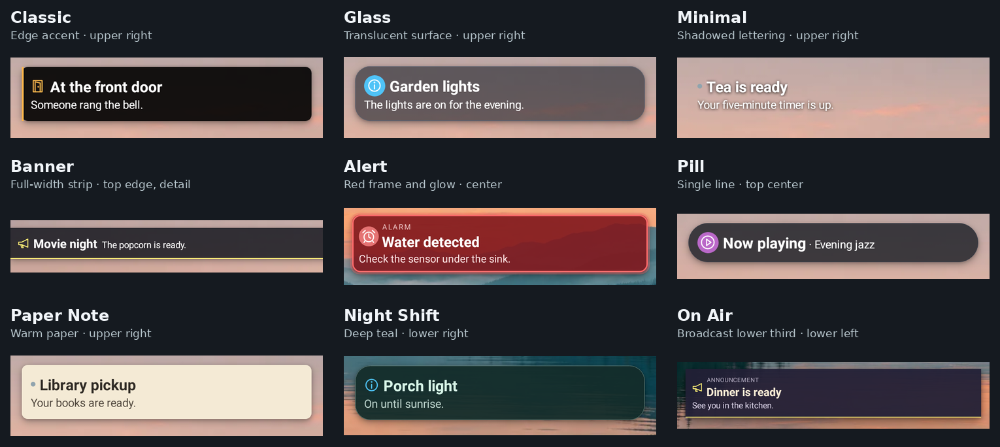
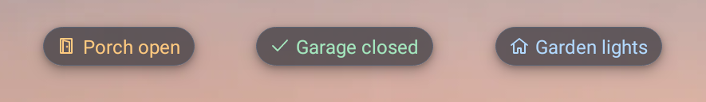
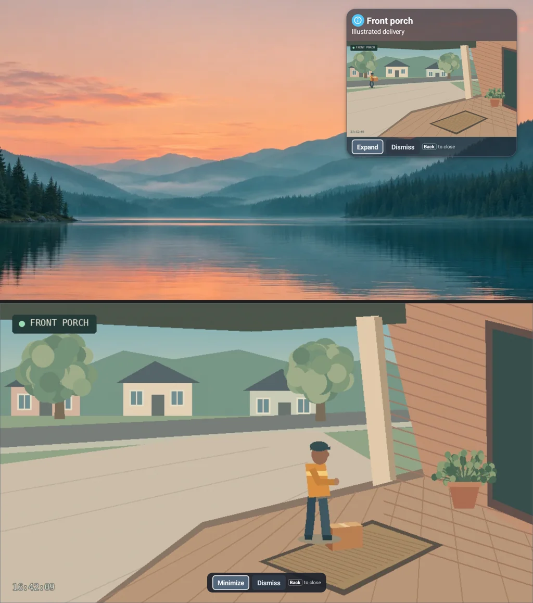
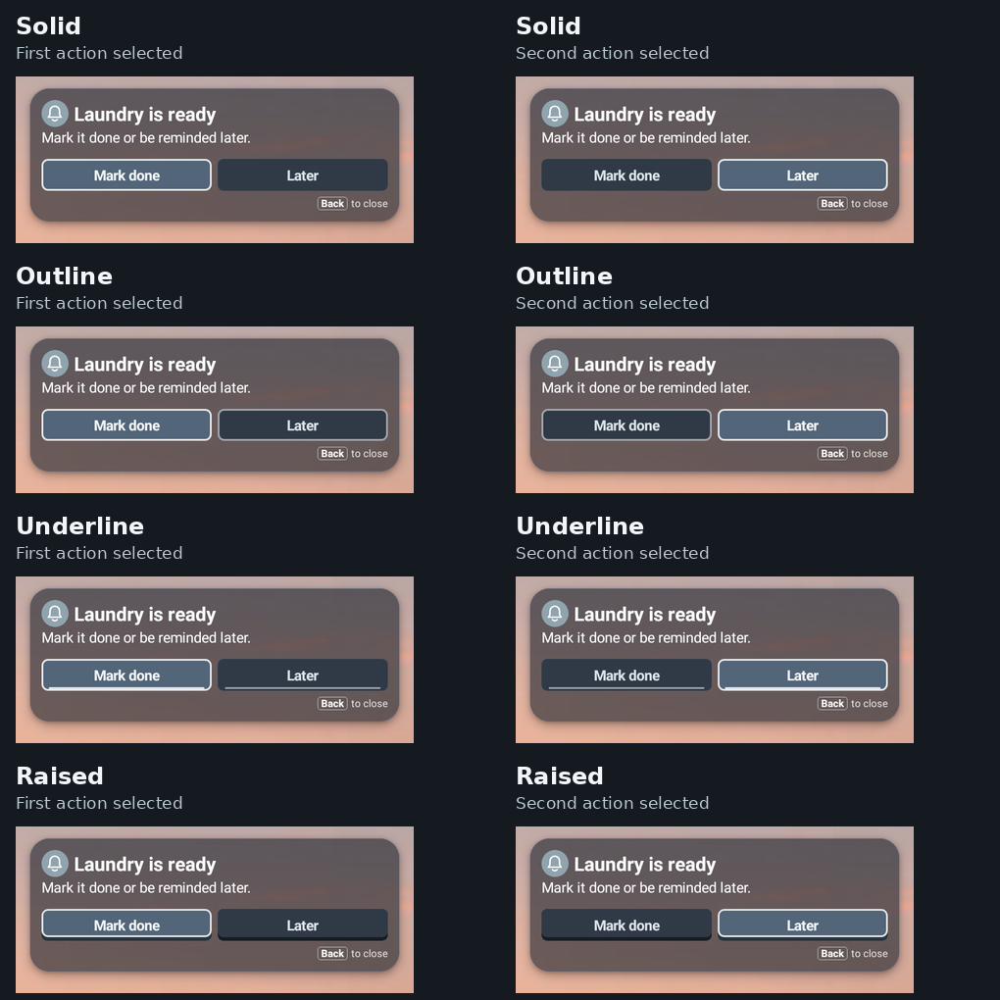
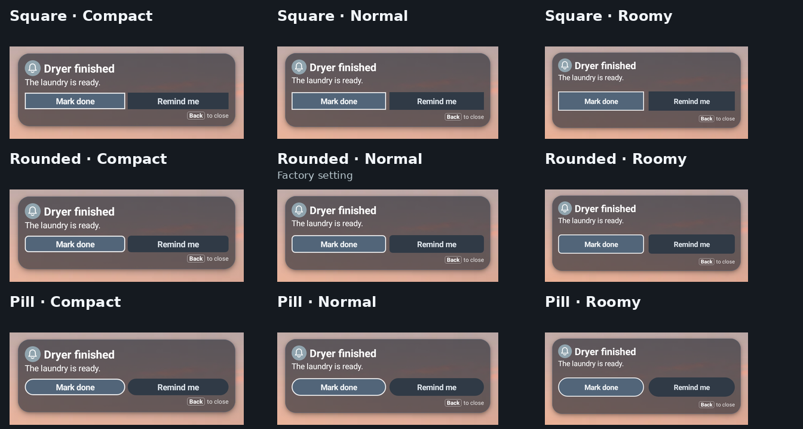
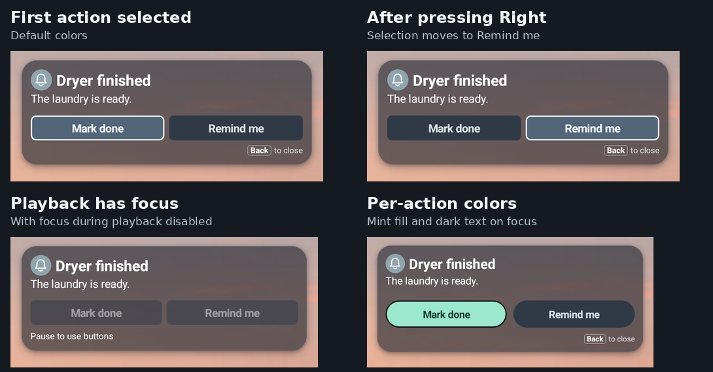

# Card styles and display policy

Open **Herald → Looks** to preview each look. Each thumbnail places the actual card over a sample TV scene. Press OK for the same scene at full size. OK or Back closes the preview, and it closes automatically after eight seconds. Hold OK to assign the look to a category. **More options → New look** copies a built-in so you can edit its appearance. Under **Categories**, choose a look, toggle Announce or tweak a style field. **Send test** posts a card using that category, including its speech policy. **More options → Reset to default** removes the tweaks and restores the default look and announce setting.

## How styles combine

Herald applies each layer in order. Later layers override only the keys they supply.

**Category base → category look → category style overrides → request look → request style → top-level icon.**

For example, post `{"category":"alarm","message":"Check now","look":"classic","style":{"icon":"bell"},"icon":"emoji:🔔"}`. Alarm's alert look supplies center placement, large size and large text. Classic keeps those three and supplies its soft shadow, black background, white text, card layout, small corner, bar and no border, glow or label. The top-level bell emoji wins over the vector bell in the request style.

The background opacity controls how much of the current app shows through the card background. The live picture uses the source brightness, follows the card corners, and sits inside the border. Video cards receive pointer input inside their window so Android can show the picture at full opacity. Touches outside a corner video card pass to the app underneath. Cards without video remain click-through. The shadow and glow extend outside the frame. Fullscreen cards have square corners and shade the caption area for readability.

## Named looks



**Paper Note** is a cream reminder with dark text. **Night Shift** sits in the lower right with a dark teal surface. **On Air** is a full-width ticker flush with the bottom of the screen. Its title stays still while long messages scroll. Omit the title to give the message the whole row. Use `paper-note`, `night-shift`, or `on-air` in an automation.

Banner spans the screen. The gallery crops it so you can read the notification at the same scale as the other cards.

These JSON objects are the complete built-in override maps. The table below them describes the underlying category defaults. A custom look can set any subset of `placement`, `size`, `text_size`, `background`, `opacity`, `layout`, `corner`, `border`, `border_color`, `shadow`, `glow`, `accent_style`, `title_color`, `text_color`, `title_weight`, `label`, the motion fields and `edge_margin` listed below, `animation` and the seven `button_` fields in the table below. An empty map leaves the previous card layer intact. See the [Looks API](API.md#looks) to save or replace one.

```json
{"classic":{"layout":"card","corner":"small","border":"none","border_color":"#FFFFFF","shadow":"soft","glow":"none","accent_style":"bar","background":"#000000","opacity":90,"title_color":"#FFFFFF","text_color":"#FFFFFF","title_weight":"bold","label":"none"},
 "glass":{"layout":"card","corner":"large","border":"thin","border_color":"#5A6272","shadow":"soft","glow":"none","accent_style":"badge","background":"#1C202A","opacity":60,"title_color":"#FFFFFF","text_color":"#FFFFFF","title_weight":"bold","label":"none"},
 "minimal":{"transition_in":"fade","transition_out":"fade","layout":"text","corner":"none","border":"none","border_color":"#FFFFFF","shadow":"none","glow":"none","accent_style":"dot","background":"#000000","opacity":0,"title_color":"#FFFFFF","text_color":"#FFFFFF","title_weight":"bold","label":"none"},
 "banner":{"transition_in":"slide_top","transition_out":"slide_top","layout":"strip","placement":"top","size":"full","corner":"none","border":"none","border_color":"#FFFFFF","shadow":"soft","glow":"none","accent_style":"underline","background":"#0C1018","opacity":80,"title_color":"#FFFFFF","text_color":"#FFFFFF","title_weight":"bold","label":"none"},
 "alert":{"layout":"card","placement":"center","size":"large","text_size":"large","corner":"medium","border":"thick","border_color":"#FF6B6B","shadow":"strong","glow":"border","accent_style":"badge","background":"#781218","opacity":85,"title_color":"#FFFFFF","text_color":"#FFE3E3","title_weight":"bold","label":"category"},
 "pill":{"layout":"pill","placement":"top","size":"medium","corner":"pill","border":"thin","border_color":"#3A404C","shadow":"soft","glow":"none","accent_style":"badge","background":"#181C24","opacity":80,"title_color":"#FFFFFF","text_color":"#FFFFFF","title_weight":"bold","label":"none"},
 "paper-note":{"layout":"card","corner":"small","border":"none","border_color":"#FFFFFF","shadow":"soft","glow":"none","accent_style":"dot","background":"#F4EAD5","opacity":100,"title_color":"#302B25","text_color":"#50473D","title_weight":"bold","label":"none","placement":"top_right","button_style":"outline","button_shape":"square","button_background":"#DFD3BB","button_text_color":"#423831","button_focus_background":"#C3AF8C","button_focus_text_color":"#28221C"},
 "night-shift":{"layout":"card","corner":"large","border":"thin","border_color":"#63817B","shadow":"soft","glow":"none","accent_style":"none","background":"#142D2B","opacity":95,"title_color":"#D7F4E7","text_color":"#BBD2CB","title_weight":"bold","label":"none","placement":"bottom_right","button_style":"raised","button_shape":"pill","button_background":"#253F3A","button_text_color":"#D1E6DB","button_focus_background":"#456658","button_focus_text_color":"#F1F8EA"},
 "on-air":{"layout":"strip","transition_in":"slide_bottom_fade","transition_out":"slide_bottom","text_animation":"ticker","edge_margin":0,"corner":"none","border":"none","border_color":"#FFFFFF","shadow":"strong","glow":"none","accent_style":"underline","background":"#222036","opacity":95,"title_color":"#FAECD5","text_color":"#DAD2E6","title_weight":"bold","label":"none","placement":"bottom","size":"full","button_style":"underline","button_shape":"square","button_background":"#39344D","button_text_color":"#DDD7E7","button_focus_background":"#635473","button_focus_text_color":"#FAF0EA"}}
```

General, announcement, reminder and system start with glass. Doorbell and camera use classic, alarm uses alert and media uses pill. All eight start with Announce off. Unknown valid category IDs resolve to general. New custom categories use general's base with glass and Announce off. The limit is 32 categories including the built-ins.

| Built-in id | Name | Icon | Accent | Seconds | Stacking | Special default |
|---|---|---|---|---:|---|---|
| general | General | info | #4FC3F7 | 10 | queue | |
| doorbell | Doorbell | door | #FFB74D | 30 | replace | |
| camera | Camera | camera | #81C784 | 30 | replace | |
| alarm | Alarm | alarm | #E57373 | 0 | replace | large size |
| media | Media | media | #BA68C8 | 12 | queue | |
| announcement | Announcement | megaphone | #FFF176 | 15 | queue | |
| reminder | Reminder | bell | #90A4AE | 12 | queue | dim at night |
| system | System | tv | #B0BEC5 | 30 | replace | |

| Field | Values and effect | Default |
|---|---|---|
| placement | top_left, top, top_right, left, center, right, bottom_left, bottom, bottom_right, fullscreen | top_right |
| size | small (24% screen width), medium (32%), large (44%), full (screen width). Fullscreen uses the screen bounds. | medium |
| text_size | small, medium, large, xlarge. Title/body sizes as % of height are 2.4/1.8, 3.0/2.2, 3.8/2.8 and 4.6/3.4. | medium |
| accent | #RRGGBB accent bar. On side and corner cards the bar faces the screen center. Other placements use the left edge. | Category accent |
| background | #RRGGBB background color | #000000 |
| opacity | Background opacity, 0–100 in steps of 5. At 0 the content remains visible. Android 12+ draws pass-through overlays at most about 80 % opaque, as seen on the onn 4K Pro and Android TV 16 emulator. | 90 |
| icon | none, info, bell, door, camera, alarm, warning, home, media, megaphone, person, package, tv, timer, check, `emoji:<text>` (1–8 Unicode code points, no whitespace, space characters or ISO controls), `image:<key>` (cached image key). A missing picture draws no icon. | Category icon |
| duration | Integer seconds 3–3600, or 0 until cleared or capped | Category duration |
| stacking | replace, queue, stack | Category stacking |
| sound | none, chime, clip:<key>. Plays through the announcement queue when the card appears, subject to night rules. Speak-and-show suppresses this sound. | none |
| sound_volume | Integer 0–100 | 60 |
| video_sound | on, off. An explicit video.muted boolean overrides it. Audible video mixes without requesting audio focus. | off |
| show_here | true, false | true |
| over_playback | show, skip | show |
| night | normal, dim, hide | normal |
| focus | auto, never | auto |
| transition_in, transition_out | none, fade, slide_auto, slide_left, slide_right, slide_top, slide_bottom, grow, shrink. Append `_fade` to any slide, grow or shrink. | slide_auto in, fade out |
| transition_expand, transition_minimize | morph, morph_fade, fade, none | morph |
| attention_animation | none, pulse, double_pulse, glow, nudge | none |
| text_animation | none, ticker (scrolls overflowing text only) | none |
| ticker_speed | slow, normal, fast (1.2, 1.8 and 2.7 em per second at the displayed text size) | normal |
| edge_margin | Whole percent of the screen on each anchored axis, 0–10. Full-width cards fill the horizontal axis. | 3 |
| animation | Legacy entrance alias: slide, fade, none. Explicit transition_in wins within the same style. | slide |
| layout | card, text, strip, pill | card |
| corner | none, small, medium, large, pill | small |
| border | none, thin, medium, thick | none |
| border_color | #RRGGBB | #FFFFFF |
| shadow | none, soft, strong | none |
| glow | none, accent, border | none |
| accent_style | bar, badge, dot, underline, none | bar |
| title_color, text_color | #RRGGBB for title and body respectively | #FFFFFF |
| title_weight | bold, normal | bold |
| button_style | solid, outline, underline, raised | solid |
| button_shape | square, rounded, pill | rounded |
| button_spacing | compact, normal, roomy | normal |
| button_background, button_text_color | #RRGGBB fill and label for an unselected action | #303A46, #DCE3EA |
| button_focus_background, button_focus_text_color | #RRGGBB fill and label for the action selected with the remote | #526579, #F3F6F8 |
| label | none, category (uppercase category name) | none |

### Layout, decorations and placement

Cards with media or buttons always use the card layout. For text-only content, `text` removes the box and adds a shadow to the text. A `strip` uses the full screen width, at the bottom for bottom placements and at the top otherwise. A `pill` uses one ellipsized line with a middle dot between title and message. Strip and pill show the icon and omit the sender line. With any layout, `accent_style:dot` replaces the icon with a dot. A badge places the icon on an accent circle, underline draws a bottom line, and none removes the accent decoration. Emoji keep their color and cached picture icons are circle-cropped.

Small, medium and large corners use 1.2%, 2% and 3% of screen height. A pill radius is half the card height. Thin, medium and thick strokes are 0.1%, 0.2% and 0.35% of screen height, at least one pixel. Soft and strong drop shadows follow the rounded edge and fade into the scene below it. Strong casts a wider, deeper shadow. The shadow stays outside the surface so translucent cards and chips keep their chosen opacity. Glow extends 0.6% in the accent or border color. Placement anchors the **content** with the configured screen edge margin (3% by default) before adding these effects. An axis filled by the content has zero margin. Decorations may clip at the screen edge. Stacking uses a 1.5% screen-height gap between content edges and centers a centered stack as a group.

Chips resolve their chosen look over the base visual defaults. They use its background, opacity, border, shadow and glow. The shape is a pill except that corner `none` gives a small radius. Each chip has padding around its contents and a gap between its icon and label when both are present. Chip color tints text and vector icons and supplies accent glow. Each position has its own bar of five plus an overflow count in the display look. Visible high chips pulse three times over 1.5 seconds on appearance, promotion, or a text, color or icon change.



### Card motion and the On Air ticker

Open **More options** in a custom Look or category to choose how cards arrive, leave, draw attention, expand and minimize. **Inherit** clears one override. Use **Preview motion** to try the effect. An ordinary card fades out in 180 ms. **Disappear instantly** removes it immediately. A directional slide names the edge it comes from on arrival or moves toward on exit. Attention plays once. System animation settings govern motion.

On Air uses zero outer margin. A short message stays still. A longer message scrolls after a short reading pause. Omit the title for a message-only ticker. Set `text_animation: none` for static text, or increase `edge_margin` to lift the strip above the bottom edge. [Watch the ticker demo](images/on-air-motion.mp4).

### Live camera view

In the corner, the title sits above the camera and the buttons sit just below it. Press OK on **Expand** and the camera fills the screen. The title fades away and **Minimize** stays selected in a small floating row near the bottom. Press OK again to return to the program, or **Back** to close the card. If several long actions share a small card, Left and Right bring the selected label into view.



The demo uses an illustrated porch delivery playing through Herald on Android TV.

[](images/porch-delivery.mp4)

[Watch the demo](images/porch-delivery.mp4) · [Open the full-resolution screenshot](images/porch-card.png) · [Use this Home Assistant automation](../examples/home-assistant.md#show-the-porch-camera-when-the-doorbell-rings)

### Admission and timers

Priority is a top-level card field (low, normal, high, critical). For each arrival or promotion, Herald evaluates same-ID updates, eligibility, category stacking, then the visible cap. Skip reasons take precedence in the order screen_off, hidden, night, over_playback. Critical bypasses hidden, night hide and playback skip.

- **Replace** ends visible cards in the same category. A noncritical arrival queues behind a critical card of that category. A critical arrival can replace any same-category card.
- **Queue** waits for all showing cards of that category to finish. **Stack** displays alongside them. At one placement the newest is nearest the top or bottom edge; center and side positions put newest on top, with 1.5% screen-height spacing.
- At the visible cap, the lowest-priority oldest noncritical card is replaced. If all are critical the arrival queues. Up to 32 queued and 16 waiting cards are admitted; higher priority then earlier arrival is served first.

A timed request while the screen is off is skipped. Screen-off expires active timed cards and moves until-cleared cards to waiting. Surplus waiting cards end as capped, lowest priority and oldest first. Screen-on readmits waiting cards. The sticky cap runs from acceptance across all states. Night uses the box's local hours. Dim multiplies opacity by 0.6, rounds to a multiple of five and steps size and text size down once.

### Buttons and playback

The default button uses a dark slate fill. Remote focus lightens it to blue-gray and adds an outline. Choose **Button style** in a category or custom Look to switch between Solid, Outline, Underline and Raised. Shape and spacing are independent. Paper Note starts with Outline, Night Shift with Raised and On Air with Underline.







On the TV, open **Looks** and edit a custom look, or open **Categories** and choose a category. Choose **Preview buttons** to try the current colors and move selection between two actions. Both sample actions close the preview.

`button_spacing` controls the gap above the row, the space between actions, the padding inside each button and the gap before the remote hint. A card without buttons reserves no action space. The selected button also gets a light or dark outline against its selected fill. Use a contrasting label color for each fill.

A single action can override any of the four palette colors through its own `style` object. Shape and spacing apply to the whole row. See the [Home Assistant example](HOME_ASSISTANT.md#actions).

The most recently accepted eligible card with buttons and focus auto can take focus. With `display.focus_while_playing:false`, buttons draw at half opacity with “Pause to use buttons” during external sound and become available when it stops. Select with Left/Right then OK. Selection starts at the first button and stops at either end. A small **Back** keycap under the actions shows how to close the focused card. A focused card handles only the four D-pad directions, D-pad center, Enter, numeric Enter and Back. Other keys pass to Android, including media and volume keys supported by the active route.

An event button emits card.button then ends the card as button. Dismiss ends it as dismissed. Expand switches to fullscreen and gives a timed card at least 60 seconds. The action becomes **Minimize**. Selecting it restores the original placement and button label while the video keeps playing. A card that starts fullscreen minimizes to the upper right. Sticky cards keep their original cap. **Back** dismisses the card at either size. See the [API](API.md) for event fields and signal timing.
